<div align="center">

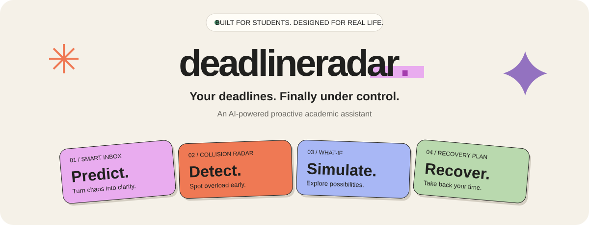

<br/>


### Predict. Simulate. Optimize. Recover.

**College is chaotic enough. Your deadlines shouldn't be.**

An AI-powered proactive academic assistant that transforms messy campus announcements into achievable academic plans.

[Explore Features](#-meet-your-new-academic-assistant) ·
[See It in Action](#-a-little-less-chaos) ·
[Under the Hood](#-under-the-hood) ·
[Getting Started](#-getting-started)

<br/>

**7 Core Features · 5 Algorithmic Engines · 24 Passing Tests**

Built for the AI Builderthon 2026 at Bennett University.

</div>

---

## 👀 First impressions

<div align="center">
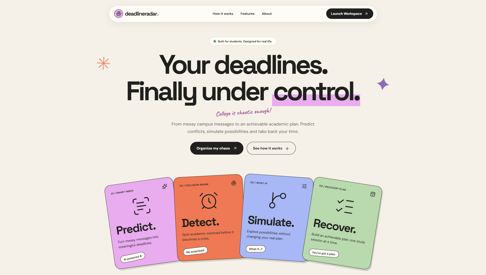
</div>

---

## 💭 Sound familiar?

It's midnight.

Your class WhatsApp group has 137 unread messages.

Someone mentioned a DBMS assignment. Someone else said the viva
is tomorrow. Your project report is due soon, and apparently
there might be a quiz next week.

And somewhere between all those messages, someone is talking
about what's for dinner.

You don't just need another to-do list.

You need to know whether you can actually finish everything.

That's where **DeadlineRadar AI** comes in.

> Traditional task managers tell you what is due.
>
> DeadlineRadar AI helps you understand whether your workload
> is achievable — and what you can change if it isn't.

---

## ✨ Meet your new academic assistant

<div align="center">
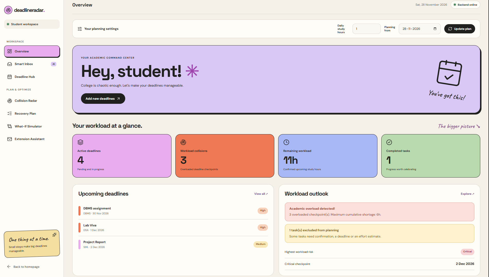
<br/>
<sub>Your entire academic workload, in one place.</sub>
</div>

<br/>

| Feature | What it does |
|---|---|
| 💌 **Smart AI Inbox** | Turns messy text and screenshots into structured deadlines. |
| 🔍 **Duplicate Detection** | Identifies repeated announcements and possible reschedules. |
| 📚 **Deadline Hub** | Organizes tasks, priorities and completion progress. |
| 🚨 **Collision Radar** | Detects academic overload before deadlines arrive. |
| 🌱 **Recovery Plan** | Builds a capacity-aware daily study schedule. |
| 🔮 **What-If Simulator** | Experiments with hypothetical changes safely. |
| ✉️ **Extension Assistant** | Calculates a feasible extension and drafts a request email. |

---

## 🎨 A little less chaos

### 01 / Smart Inbox

**Messy messages in. Organized deadlines out.**

Paste a WhatsApp message, email or academic announcement.
Alternatively, upload a screenshot of a notice.

Gemini understands English, Hindi and Hinglish and extracts
relevant academic information.

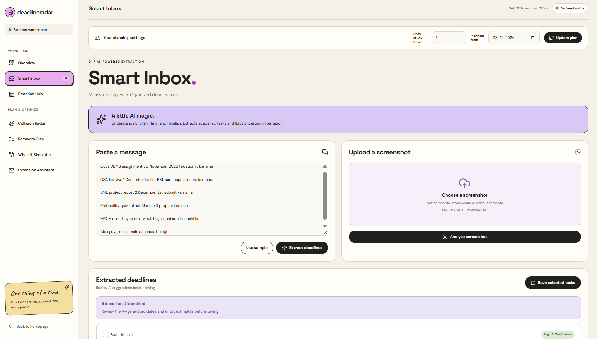

The extraction identifies:

- Subject and task type
- Submission date
- Suggested study hours
- Priority and AI confidence
- Ambiguous or missing information
- Original announcement

Uncertain information is flagged for review instead of being
silently treated as confirmed.

### 02 / Duplicate and Reschedule Detection

**Because one assignment shouldn't become three.**

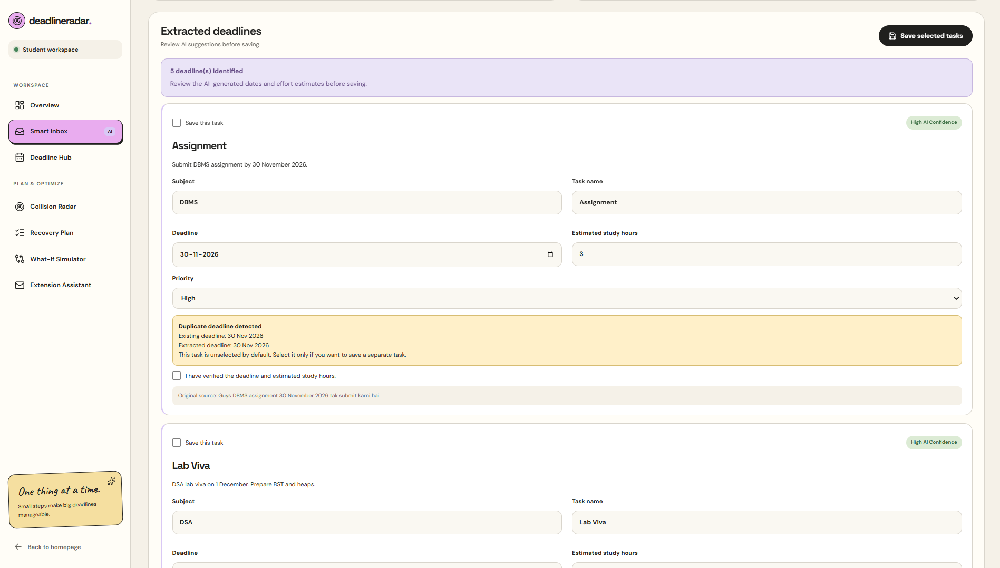

DeadlineRadar compares extracted announcements against existing
tasks using normalized text and sequence similarity.

It distinguishes between:

- New tasks
- Duplicate announcements
- Possible deadline reschedules
- Potential matches with uncertain dates

Students remain in control of what gets saved.

### 03 / Deadline Hub

**Every assignment, exam and viva. Finally in one place.**

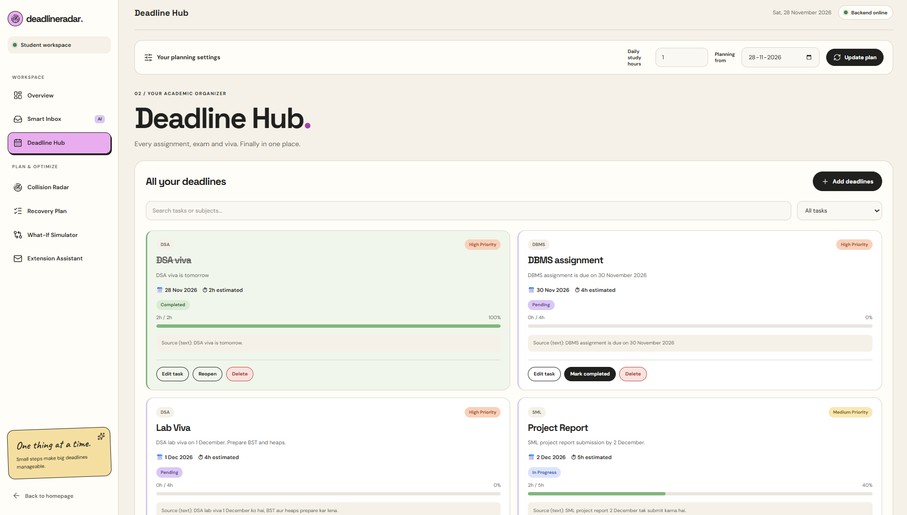

Search, filter, edit and track academic tasks.

Update estimated effort, record completed study hours,
mark tasks as complete or reopen them when necessary.

Unconfirmed deadlines remain visible without being included
in confirmed workload calculations.

### 04 / Collision Radar

**Find academic overload before it finds you.**

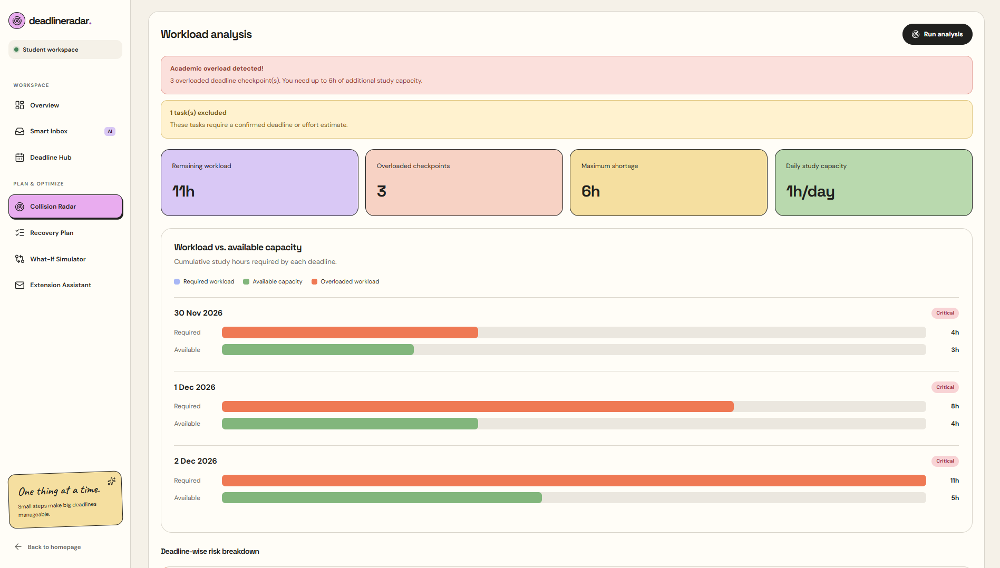

The engine compares cumulative remaining workload against
available study capacity at every deadline checkpoint.

In the illustrated scenario:

| Metric | Result |
|---|---:|
| Confirmed remaining workload | 11 hours |
| Available study capacity | 1 hour/day |
| Overloaded checkpoints | 3 |
| Maximum workload shortage | 6 hours |

Risk is classified as Low, Moderate, High or Critical.

This is not just a deadline reminder. It is a mathematical
assessment of workload feasibility.

### 05 / Recovery Plan

**You've got a plan.**

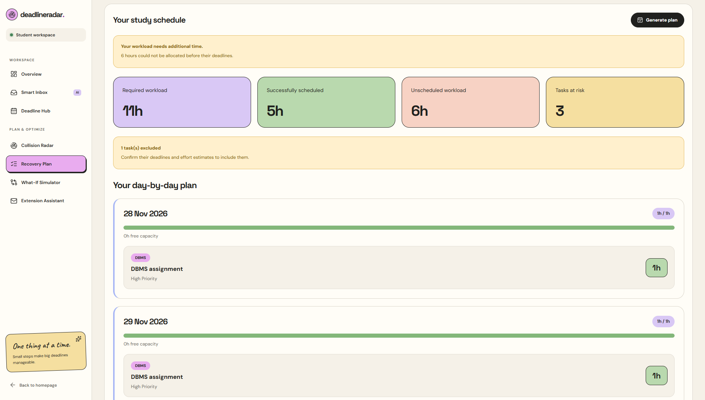

An Earliest Deadline First scheduling algorithm distributes
remaining academic work across available study days.

It considers:

- Upcoming deadlines
- Task priority
- Previously completed work
- Daily study capacity

If the entire workload cannot fit, the scheduler reports
unscheduled hours and tasks at risk instead of creating
an unrealistic timetable.

### 06 / What-If Simulator

**What if things could be different?**

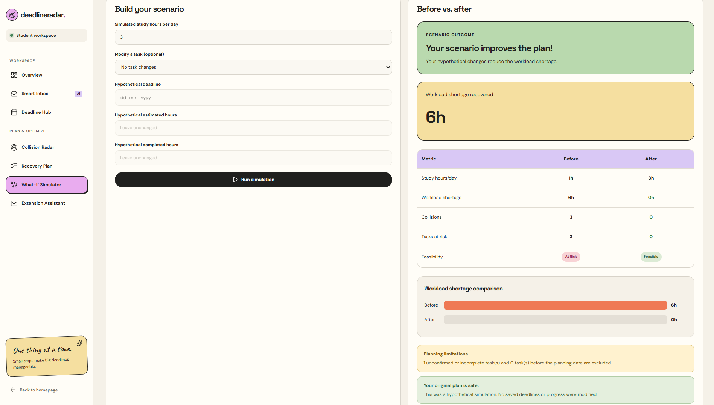

Experiment with study availability, alternative deadlines,
estimated effort and hypothetical progress.

The example below increases daily availability from
one hour to three hours.

| Metric | Before | After |
|---|---:|---:|
| Study hours/day | 1h | 3h |
| Workload shortage | 6h | 0h |
| Collisions | 3 | 0 |
| Tasks at risk | 3 | 0 |
| Feasibility | At Risk | Feasible |

**No saved deadlines or task progress are modified.**

Explore possibilities before committing to a decision.

### 07 / Extension Assistant

**Ask for what you actually need.**

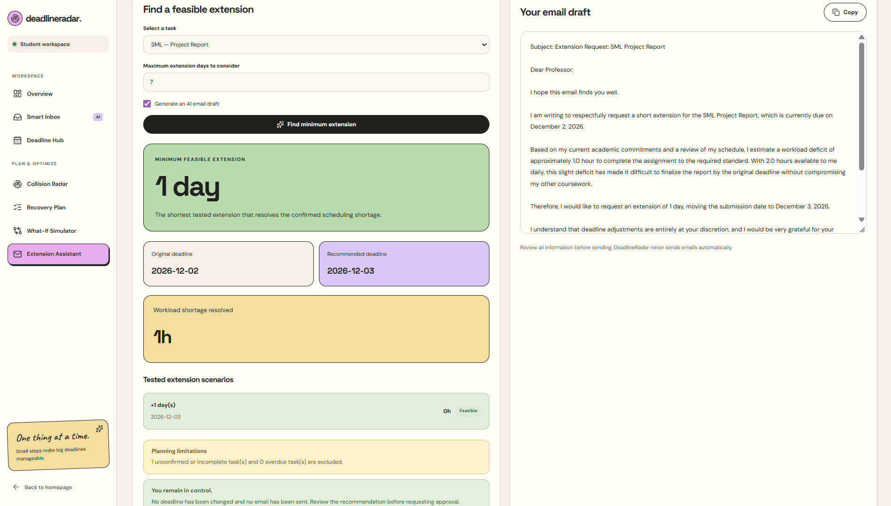

Instead of requesting an arbitrary extension, DeadlineRadar
tests alternative submission dates and identifies the shortest
extension that makes the confirmed schedule feasible.

In the illustrated scenario:

- Original deadline: 2 December 2026
- Recommended deadline: 3 December 2026
- Minimum feasible extension: 1 day
- Workload shortage recovered: 1 hour

Gemini can then draft a respectful extension request based
on the calculated recommendation.

No email is automatically sent, and no deadline is changed.

Professor approval is always required.

---

## 🧩 More than another AI wrapper

DeadlineRadar AI combines generative AI with deterministic
decision-making algorithms.

| Traditional task manager | DeadlineRadar AI |
|---|---|
| Manual task entry | Multimodal AI extraction |
| Deadline reminders | Predictive workload analysis |
| Static task lists | Capacity-aware scheduling |
| Manual planning | What-if simulations |
| Arbitrary extension requests | Minimum feasible extension search |
| Repeated announcements | Duplicate and reschedule detection |

### AI understands. Algorithms calculate. You decide.

| Generative AI | Deterministic Python |
|---|---|
| Language understanding | Duplicate similarity |
| Screenshot interpretation | Workload collision detection |
| Structured deadline extraction | Study scheduling |
| Suggested effort estimation | Scenario simulation |
| Email drafting | Minimum extension search |

The language model does not decide whether a schedule
is mathematically feasible.

---

## 🧠 Under the hood

### System architecture

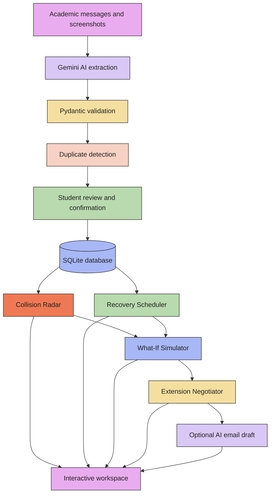

<details>
<summary><b>🔍 Engine 01 — Duplicate Detection</b></summary>

<br/>

Task names and subjects are normalized before comparison.

Sequence similarity helps identify announcements that may
refer to the same academic task.

Matching tasks are classified according to their deadline
information.

The approach is heuristic, so potential matches require
student review.

**Source:** `engines/duplicate_detector.py`

</details>

<details>
<summary><b>🚨 Engine 02 — Workload Collision Detection</b></summary>

<br/>

For each confirmed deadline checkpoint:

```text
Remaining Work = max(0, Estimated Hours - Completed Hours)

Available Hours = Available Days × Daily Study Hours

Workload Deficit = max(0, Cumulative Workload - Available Hours)
```

Deadlines are evaluated chronologically.

A positive deficit indicates that the confirmed workload
exceeds available study capacity at that checkpoint.

Unconfirmed and overdue tasks are handled separately.

**Source:** `engines/collision_detector.py`

</details>

<details>
<summary><b>📅 Engine 03 — Earliest Deadline First Scheduling</b></summary>

<br/>

Tasks are sorted by approaching deadlines, with priority
used to break deadline ties.

Remaining work is allocated across available study days
without exceeding daily capacity or task deadlines.

Unallocated work is reported explicitly.

**Source:** `engines/scheduler.py`

</details>

<details>
<summary><b>🔮 Engine 04 — Scenario Simulation</b></summary>

<br/>

The simulator creates an independent copy of the task data.

Hypothetical changes are applied to this copy before
recalculating workload collisions and scheduling feasibility.

Baseline and simulated outcomes are then compared.

The original task data remains unchanged.

**Source:** `engines/simulator.py`

</details>

<details>
<summary><b>✉️ Engine 05 — Minimum Extension Search</b></summary>

<br/>

The extension engine evaluates consecutive alternative
submission dates, starting with one additional day.

The first extension that produces a feasible schedule
within the selected search limit is recommended.

If no feasible extension exists, the system reports that
extending the selected task alone is insufficient.

**Source:** `engines/extension_negotiator.py`

</details>

---

## 🛠️ Built with

<div align="center">


</div>

<br/>

| Component | Technology |
|---|---|
| Backend | Python, Flask |
| Frontend | HTML5, CSS3, Vanilla JavaScript |
| Generative AI | Google Gemini API |
| Structured validation | Pydantic |
| Database | SQLite |
| ORM | Flask-SQLAlchemy |
| Testing | Pytest |
| Version control | Git and GitHub |
| Icons | Lucide |
| Typography | Google Fonts |

---

## 🚀 Getting started

Run DeadlineRadar AI locally on your own machine.

### Prerequisites

- Python 3.10 or newer
- Git
- Gemini API key with access to the configured model

Developed and tested using Python 3.13.

<details open>
<summary><b>Step 1 — Clone the repository</b></summary>

<br/>

```bash
git clone https://github.com/vanshianeja/DeadlineRadar-AI.git
cd DeadlineRadar-AI
```

</details>

<details>
<summary><b>Step 2 — Create a virtual environment</b></summary>

<br/>

```bash
python -m venv .venv
```

Windows PowerShell:

```powershell
.venv\Scripts\Activate.ps1
```

macOS / Linux:

```bash
source .venv/bin/activate
```

</details>

<details>
<summary><b>Step 3 — Install dependencies</b></summary>

<br/>

```bash
pip install -r requirements.txt
```

</details>

<details>
<summary><b>Step 4 — Configure Gemini</b></summary>

<br/>

Copy `.env.example` to `.env`.

Windows PowerShell:

```powershell
Copy-Item .env.example .env
```

macOS / Linux:

```bash
cp .env.example .env
```

Configure the environment variables:

```env
GEMINI_API_KEY=your_api_key_here
GEMINI_MODEL=gemini-3.5-flash-lite
```

Obtain an API key from [Google AI Studio](https://aistudio.google.com/).

Use a model available to your API account.

Never commit your actual API key.

</details>

<details open>
<summary><b>Step 5 — Launch DeadlineRadar AI</b></summary>

<br/>

```bash
python -m flask --app app run
```

Open your browser:

**http://127.0.0.1:5000**

The SQLite database is initialized automatically.

</details>

---

## 📂 Project structure

<details>
<summary><b>Explore the source code</b></summary>

<br/>

```text
DeadlineRadar-AI/
├── app.py
├── models.py
├── schemas.py
├── engines/
│   ├── extractor.py
│   ├── duplicate_detector.py
│   ├── collision_detector.py
│   ├── scheduler.py
│   ├── simulator.py
│   ├── extension_negotiator.py
│   └── email_generator.py
├── templates/
│   ├── index.html
│   └── workspace.html
├── static/
│   ├── css/
│   └── js/
├── assets/
│   ├── banner.svg
│   └── screenshots/
├── data/
│   ├── sample_messages.json
│   └── sample_notice.png
├── conftest.py
├── pytest.ini
├── test_collision_detector.py
├── test_duplicate_detector.py
├── test_scheduler.py
├── test_simulator.py
├── test_extension_negotiator.py
├── test_extractor.py
├── test_image_extractor.py
├── test_gemini.py
├── requirements.txt
├── .env.example
├── .gitignore
└── README.md
```

</details>

---

## 🔌 API reference

<details>
<summary><b>Explore the Flask API endpoints</b></summary>

<br/>

| Method | Endpoint | Purpose |
|---|---|---|
| GET | `/api/health` | Application health |
| POST | `/api/extract/text` | Text deadline extraction |
| POST | `/api/extract/image` | Image deadline extraction |
| GET | `/api/tasks` | Retrieve tasks |
| POST | `/api/tasks` | Save reviewed tasks |
| PATCH | `/api/tasks/<id>` | Update task details |
| DELETE | `/api/tasks/<id>` | Delete a task |
| GET | `/api/collisions` | Analyze workload |
| GET | `/api/schedule` | Generate study schedule |
| POST | `/api/simulate` | Simulate scenarios |
| POST | `/api/extension` | Recommend an extension |

</details>

---

## 🧪 Tested, not just demonstrated

<div align="center">


</div>

| Algorithmic engine | Tests passed |
|---|---:|
| Collision Detector | 5/5 |
| Duplicate Detector | 4/4 |
| Smart Scheduler | 5/5 |
| What-If Simulator | 5/5 |
| Extension Negotiator | 5/5 |
| **Total** | **24/24** |

Latest recorded local test result:

```text
================== 24 passed in 0.10s ==================
```

Run the deterministic test suite:

```bash
python -m pytest -v
```

These tests do not require live Gemini API requests.

Separate manual scripts are provided for testing Gemini
connectivity and text/image extraction.

---

## 🎯 Try these scenarios

<details>
<summary><b>Case 01 — The chaotic class group chat</b></summary>

<br/>

Paste a message such as:

```text
Guys DBMS assignment 30 November 2026 tak submit karni hai.

DSA lab viva 1 December ko hai.
BST aur heaps prepare kar lena.

SML project report 2 December tak submit karna hai.

Probability quiz kal hai.

MPCA quiz shayad next week hoga,
abhi confirm nahi hai.

Also guys, mess mein aaj pasta hai.
```

Review the extracted academic tasks, relative dates,
duplicate warnings and uncertain announcements.

The pasta announcement should not become a deadline.

Use a current announcement when trying relative dates
such as "kal", because extraction depends on the reference date.

</details>

<details>
<summary><b>Case 02 — Too much work, too little time</b></summary>

<br/>

Recreate the illustrated scenario using a planning date
of 28 November 2026:

| Task | Deadline | Remaining effort |
|---|---|---:|
| DBMS assignment | 30 Nov | 4h |
| DSA lab viva | 1 Dec | 4h |
| SML project report | 2 Dec | 3h |

Set daily study capacity to one hour.

Explore Collision Radar and the Recovery Plan.

Then simulate increasing availability to three hours per day.

Compare the workload shortage before and after the simulation.

</details>

---

## 🔐 Responsible AI and privacy

DeadlineRadar AI is designed to support student decisions,
not make academic commitments on their behalf.

- AI-generated effort estimates are editable suggestions.
- Ambiguous deadlines require user review.
- Unconfirmed tasks are excluded from confirmed planning.
- Simulations do not modify saved task data.
- Extension emails are drafts and are never sent automatically.
- API credentials and local databases are excluded from Git.
- Submitted text and images are processed through Gemini.

Avoid uploading confidential or personal information
without appropriate permission.

---

## 🌱 What's next?

### Built and tested locally

- [x] Multilingual text extraction
- [x] Screenshot-based deadline extraction
- [x] Duplicate and reschedule detection
- [x] Deadline management
- [x] Workload collision analysis
- [x] Capacity-aware recovery scheduling
- [x] What-if simulation
- [x] Minimum extension recommendation
- [x] AI-assisted email drafting
- [x] Automated algorithmic tests

### Future roadmap

- [ ] Isolated guest workspaces
- [ ] Public cloud deployment
- [ ] Persistent user accounts
- [ ] Personalized effort estimation
- [ ] Variable daily study availability
- [ ] College timetable integration
- [ ] Calendar synchronization
- [ ] Automated reminders
- [ ] Advanced semantic duplicate detection
- [ ] Multi-task deadline optimization

<details>
<summary><b>Current limitations</b></summary>

<br/>

- The current application is a single-user prototype.
- Authentication and isolated user accounts are not implemented.
- Daily study capacity is modeled uniformly.
- Scheduling primarily operates at calendar-date granularity.
- Effort estimates depend on AI suggestions and student input.
- Duplicate detection uses heuristic similarity.
- AI extraction depends on model accuracy and API availability.
- Extension recommendations do not guarantee professor approval.

</details>

---

## 🤝 Development and AI assistance

DeadlineRadar AI was developed as an individual
AI Builderthon project.

Generative AI tools, including ChatGPT, assisted with
brainstorming, architecture, implementation, frontend
development, debugging, testing and documentation.

Google Gemini is integrated into the application for
multimodal deadline extraction and email drafting.

The project combines AI-assisted development with
student-led problem selection, feature decisions,
integration and local functional verification.

Third-party libraries and services are used through
their respective packages and APIs.

---

<div align="center">

## 💜 Meet the developer

**Vanshi Aneja**

B.Tech Computer Science Engineering  
Bennett University

[](https://github.com/vanshianeja)

Developed for the AI Builderthon 2026.

<br/>

⭐ If you find this project useful, consider starring the repository.

<br/>

---

### Don't just track deadlines. Stay ahead of them.

*One thing at a time. You've got this.*


</div>