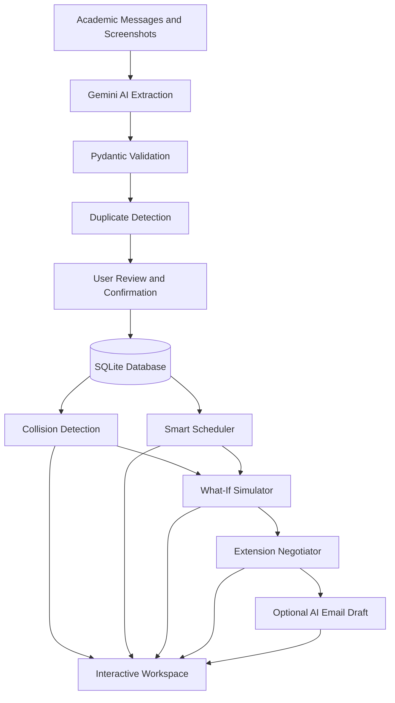

# DeadlineRadar AI

### Predict. Simulate. Optimize. Recover.

An AI-powered proactive academic assistant that helps university
students turn scattered academic announcements into actionable
deadlines, identify workload conflicts, and recover from
overloaded schedules.


## The Problem

University students receive academic deadlines through multiple
channels, including WhatsApp groups, emails, classroom
announcements and screenshots.

Important information often gets buried in conversations.
Students may know their deadlines but still struggle to
understand whether their workload is realistically manageable.

Traditional task managers answer:

> What do I need to complete?

DeadlineRadar AI goes further:

> Can I actually complete everything on time, and what can
> I change if I cannot?

## Key Features

### 1. Smart AI Inbox

- Extracts academic deadlines from unstructured text and images.
- Understands English, Hindi and Hinglish announcements.
- Identifies subjects, task types, deadlines and estimated effort.
- Resolves relative dates when sufficient context is available.
- Flags ambiguous announcements for user confirmation.
- Ignores unrelated conversation.

### 2. Duplicate and Reschedule Detection

- Identifies repeated academic announcements.
- Detects potentially rescheduled deadlines.
- Uses normalized text and sequence similarity.
- Allows students to review possible matches before saving.

### 3. Deadline Hub

- Centralized academic task management.
- Editable deadlines and estimated completion hours.
- Search and filtering.
- Progress tracking and completion status.
- Separate identification of unconfirmed deadlines.

### 4. Collision Radar

Predicts academic workload conflicts before deadlines arrive.

The engine compares cumulative remaining workload against
available study hours at each deadline checkpoint.

It classifies workload risk into:

- Low
- Moderate
- High
- Critical

Students can identify upcoming shortages and understand
which deadlines contribute to an overloaded schedule.

### 5. Smart Recovery Plan

Generates a day-by-day study schedule using an
Earliest Deadline First scheduling strategy.

The scheduler:

- Prioritizes approaching deadlines.
- Considers task priority when deadlines are equal.
- Accounts for previously completed work.
- Respects daily study capacity.
- Identifies tasks that cannot be completed within
  their available time.

### 6. What-If Simulator

Allows students to experiment with hypothetical changes
without modifying their saved academic deadlines.

Students can simulate:

- Increased or reduced daily study hours.
- Alternative submission dates.
- Changes in estimated workload.
- Hypothetical task progress.

The simulator compares baseline and simulated outcomes,
including workload shortages, collisions, feasibility
and tasks at risk.

### 7. Smart Extension Assistant

Instead of requesting an arbitrary deadline extension,
students can calculate the minimum extension required
for a selected task to make their confirmed workload feasible.

The assistant:

- Evaluates consecutive possible extension dates.
- Identifies the earliest feasible alternative.
- Quantifies the estimated workload shortage recovered.
- Generates an optional AI-assisted extension request email.
- Never automatically sends emails or changes deadlines.

## What Makes DeadlineRadar AI Different?

DeadlineRadar AI combines generative AI with deterministic
decision-making algorithms.

| Traditional Task Manager | DeadlineRadar AI |
|---|---|
| Manual task entry | AI-powered text and image extraction |
| Deadline reminders | Predictive workload collision detection |
| Static task lists | Capacity-aware study scheduling |
| Manual planning | Interactive what-if simulations |
| Arbitrary extension requests | Calculated extension recommendations |
| Repeated announcements | Duplicate and reschedule detection |

AI handles language understanding and email drafting,
while Python algorithms handle workload calculations,
scheduling, simulation and extension recommendations.

## System Architecture



## Core Algorithms

### Workload Collision Detection

For each confirmed deadline checkpoint:

```text
Remaining Work = Estimated Hours - Completed Hours

Available Hours = Available Days × Daily Study Hours

Workload Deficit = max(0, Cumulative Workload - Available Hours)
```

The engine evaluates deadlines chronologically to identify
when available study capacity becomes insufficient.

### Earliest Deadline First Scheduling

Tasks are sorted by deadline, followed by priority when
deadlines are equal.

Remaining work is allocated across available days without
exceeding daily study capacity or task deadlines.

### Scenario Simulation

The simulator creates an independent copy of the task data,
applies hypothetical changes and recalculates workload
collisions and scheduling feasibility.

The original task data remains unchanged.

### Minimum Extension Search

The extension engine evaluates possible extensions
incrementally, beginning with one additional day.

The first extension that produces a feasible schedule
is recommended within the selected search limit.

If no feasible extension exists, the system reports
that extending the selected task alone is insufficient.

## Technology Stack

| Component | Technology |
|---|---|
| Backend | Python, Flask |
| Frontend | HTML5, CSS3, Vanilla JavaScript |
| Generative AI | Google Gemini API |
| Data Validation | Pydantic |
| Database | SQLite |
| ORM | Flask-SQLAlchemy |
| Automated Testing | Pytest |
| Version Control | Git and GitHub |
| Icons | Lucide |
| Typography | Google Fonts |

## Getting Started

### Prerequisites

- Python 3.10 or newer
- Git
- A Gemini API key with access to the configured model

The application was developed and tested using Python 3.13.

### 1. Clone the repository

```bash
git clone https://github.com/vanshianeja/DeadlineRadar-AI.git
cd DeadlineRadar-AI
```

### 2. Create a virtual environment

```bash
python -m venv .venv
```

Windows PowerShell:

```powershell
.venv\Scripts\Activate.ps1
```

macOS or Linux:

```bash
source .venv/bin/activate
```

### 3. Install dependencies

```bash
pip install -r requirements.txt
```

### 4. Configure environment variables

Copy `.env.example` to `.env`.

Windows PowerShell:

```powershell
Copy-Item .env.example .env
```

macOS or Linux:

```bash
cp .env.example .env
```

Configure the following variables:

```env
GEMINI_API_KEY=your_api_key_here
GEMINI_MODEL=gemini-3.5-flash-lite
```

Use a Gemini model available to your API account.

Never commit your actual API key to version control.

### 5. Run the application

```bash
python -m flask --app app run
```

Open:

```text
http://127.0.0.1:5000
```

The SQLite database is initialized automatically.

## Project Structure

```text
DeadlineRadar-AI/
├── app.py
├── models.py
├── schemas.py
├── engines/
│   ├── extractor.py
│   ├── duplicate_detector.py
│   ├── collision_detector.py
│   ├── scheduler.py
│   ├── simulator.py
│   ├── extension_negotiator.py
│   └── email_generator.py
├── templates/
│   ├── index.html
│   └── workspace.html
├── static/
│   ├── css/
│   └── js/
├── data/
│   ├── sample_messages.json
│   └── sample_notice.png
├── conftest.py
├── pytest.ini
├── test_collision_detector.py
├── test_duplicate_detector.py
├── test_scheduler.py
├── test_simulator.py
├── test_extension_negotiator.py
├── test_extractor.py
├── test_image_extractor.py
├── test_gemini.py
├── requirements.txt
├── .env.example
├── .gitignore
└── README.md
```

## API Endpoints

| Method | Endpoint | Purpose |
|---|---|---|
| GET | `/api/health` | Application health check |
| POST | `/api/extract/text` | Extract deadlines from text |
| POST | `/api/extract/image` | Extract deadlines from images |
| GET | `/api/tasks` | Retrieve saved tasks |
| POST | `/api/tasks` | Save confirmed or reviewed tasks |
| PATCH | `/api/tasks/<id>` | Update task details |
| DELETE | `/api/tasks/<id>` | Delete a task |
| GET | `/api/collisions` | Analyze workload conflicts |
| GET | `/api/schedule` | Generate a study schedule |
| POST | `/api/simulate` | Evaluate hypothetical scenarios |
| POST | `/api/extension` | Recommend an extension |

## Automated Testing

The core algorithmic engines have been tested using Pytest.

| Engine | Tests Passed |
|---|---:|
| Collision Detector | 5/5 |
| Duplicate Detector | 4/4 |
| Smart Scheduler | 5/5 |
| What-If Simulator | 5/5 |
| Extension Negotiator | 5/5 |
| **Total** | **24/24** |

Latest local test result:

```text
24 passed in 0.10s
```

Run the deterministic test suite:

```bash
python -m pytest -v
```

These tests do not require live Gemini API requests.

Separate manual scripts are provided for testing the
Gemini connection and text/image extraction.

## Example Use Cases

### Case 1: Unstructured Academic Announcements

A student receives a group message containing multiple
assignment deadlines, viva announcements, tentative quiz
dates and unrelated conversation.

DeadlineRadar AI extracts the relevant academic tasks,
flags uncertain information and allows the student
to review the results before saving.

### Case 2: Academic Workload Overload

A student has 11 remaining hours of confirmed academic
work and only five available study hours before the
relevant deadlines.

The system identifies a six-hour workload shortage,
generates a capacity-aware recovery plan and allows
the student to simulate alternative study availability
or deadline extensions.

## Responsible AI and Privacy

- AI-generated workload estimates are editable suggestions.
- Ambiguous deadlines require user review.
- Unconfirmed tasks are excluded from deterministic planning.
- Hypothetical simulations do not modify saved task data.
- Extension emails are drafts and require manual review.
- API credentials and local databases are excluded from Git.
- Text and images submitted for AI extraction are processed
  through the Gemini API.

Users should avoid submitting confidential academic
or personal information without appropriate permission.

## Current Limitations

- The current version is a single-user prototype.
- Authentication and individual user accounts are not implemented.
- Study availability is modeled using uniform daily capacity.
- Scheduling operates primarily at calendar-date granularity.
- Estimated task durations depend on AI suggestions and user input.
- Duplicate detection uses heuristic similarity and may
  occasionally produce incorrect matches.
- AI extraction depends on API availability and model accuracy.
- Extension recommendations do not guarantee professor approval.

## Future Improvements

- Personalized effort estimation based on completion history.
- Variable daily availability and college timetable integration.
- Calendar synchronization.
- Automated reminder notifications.
- Multi-user authentication and isolated workspaces.
- More advanced semantic duplicate detection.
- Multi-task deadline optimization.

## Development and AI Assistance

DeadlineRadar AI was developed as an individual
AI Builderthon project.

Generative AI tools, including ChatGPT, were used to assist
with brainstorming, architecture, implementation, frontend
development, debugging, testing and documentation.

Google Gemini is integrated into the application for
multimodal deadline extraction and email drafting.

The project combines AI-assisted development with
student-led problem selection, feature decisions,
integration and local functional verification.

Third-party libraries and services are used through
their respective packages and APIs.

## Author

**Vanshi Aneja**

B.Tech Computer Science Engineering

Bennett University

Developed for the AI Builderthon 2026.

---

**Don't just track deadlines. Stay ahead of them.**